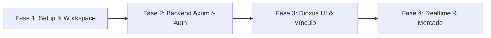
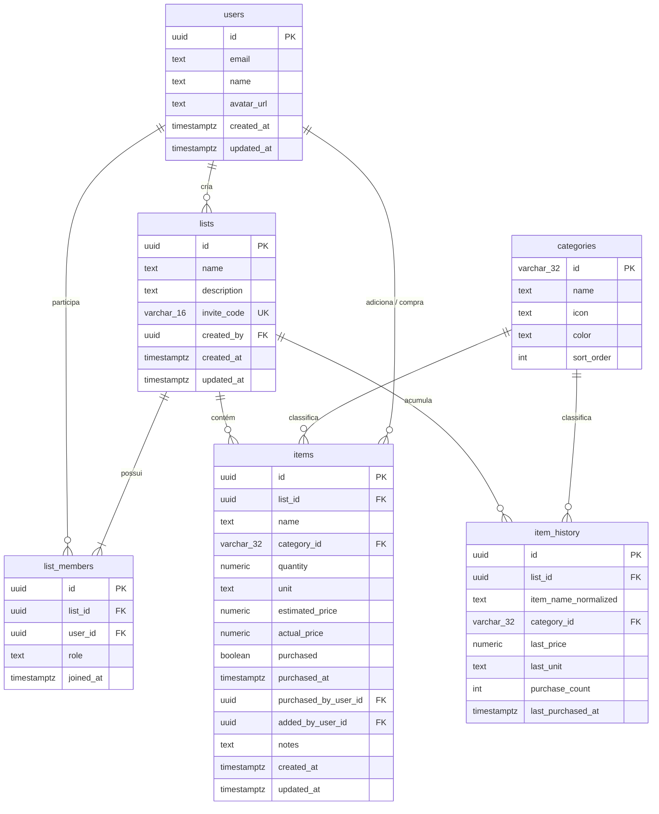

# Arquitetura e Engenharia: App Compras Colaborativo

Aplicativo multiplataforma (Android, Desktop e Web) de Lista de Compras Colaborativa, desenvolvido 100% em **Rust** utilizando **Dioxus** no cliente e **Axum** no servidor com **Supabase (PostgreSQL)** e **WebSockets** em tempo real, operando totalmente dentro de planos gratuitos permanentes (Free Tier).

---

## 1. Diagnóstico do Ambiente Local e Guia de Build Android

### 1.1 Status Atual do Ambiente (Windows x86_64)

| Componente | Requisito | Status Detectado | Detalhes |
| :--- | :--- | :--- | :--- |
| **Git** | Sistema de Controle de Versão | ✅ Instalado | `git version 2.56.0.windows.4` |
| **Rust Toolchain** | `rustc` & `cargo` | ✅ Instalado | `rustc 1.94.0` / `cargo 1.94.0` (`stable-x86_64-pc-windows-msvc`) |
| **Linker C/C++** | MSVC Linker | ✅ Funcional | Compilação e linking nativo validados com sucesso |
| **Rustup Targets** | Wasm & Android | ✅ Instalados | `wasm32-unknown-unknown`, `aarch64-linux-android`, `armv7-linux-androideabi`, `i686-linux-android`, `x86_64-linux-android` |
| **Cargo Binstall** | Instalador rápido de binários | ✅ Instalado | `cargo-binstall v1.26.2` |
| **Dioxus CLI** | `dx` | ✅ Instalado | `dioxus 0.7.10` em `%USERPROFILE%\.cargo\bin\dx.exe` |
| **Android SDK** | Plataforma Android | ⚠️ Presente em disco | Localizado em `C:\Users\yadur\AppData\Local\Android\Sdk` |
| **Android NDK** | Compilação C/Rust p/ Android | ⚠️ Presente em disco | Versão `28.2.13676358` instalada |
| **Android Build-Tools** | Ferramentas de Empacotamento | ⚠️ Presente em disco | Versões `34.0.0`, `35.0.0`, `36.1.0` disponíveis |
| **Java JDK** | JDK 17+ (Java Development Kit) | ⚠️ JRE 8 detectado | Falta `javac` e JDK 17+ para geração do APK |

### 1.2 Instruções para Habilitação do Build Android (Fase 3)

Para compilar o APK Android via `dx build --platform android`, realize os seguintes passos prévios:

1. **Instalar o Java JDK 17 (LTS recomendado para Android build tools):**
   ```powershell
   winget install EclipseAdoptium.Temurin.17.JDK
   ```
2. **Configurar as Variáveis de Ambiente no Windows:**
   ```powershell
   # Configurar ANDROID_HOME
   [Environment]::SetEnvironmentVariable("ANDROID_HOME", "$env:LOCALAPPDATA\Android\Sdk", "User")
   
   # Configurar ANDROID_NDK_HOME
   [Environment]::SetEnvironmentVariable("ANDROID_NDK_HOME", "$env:LOCALAPPDATA\Android\Sdk\ndk\28.2.13676358", "User")
   
   # Adicionar platform-tools ao PATH
   $currentPath = [Environment]::GetEnvironmentVariable("Path", "User")
   [Environment]::SetEnvironmentVariable("Path", "$currentPath;$env:LOCALAPPDATA\Android\Sdk\platform-tools", "User")
   ```
3. **Instalar o `cargo-ndk` (utilizado pelo Dioxus CLI internamente):**
   ```powershell
   cargo binstall cargo-ndk --no-confirm
   ```

---

## 2. Roadmap do Projeto em 4 Fases



### **Fase 1: Setup, Workspace e Contratos (Atual)**
- [x] Verificação e instalação completa do ambiente local (Rust, MSVC, Wasm, Android targets, `dx`).
- [x] Definição da arquitetura e documento `ARCHITECTURE.md`.
- [x] Modelagem do banco de dados relacional PostgreSQL no Supabase com script de migração `001_initial_schema.sql`.
- [x] Estruturação do Cargo Workspace (`shared`, `backend`, `frontend`).
- [x] Implementação integral do crate `shared`: modelos de domínio, DTOs de API REST, enums de categorias com algoritmo de autocategorização em português, e mensagens WebSocket.
- [x] Validação com `cargo check --workspace` e `cargo test --package shared`.

### **Fase 2: Backend Axum, Auth e WebSockets**
- Integração do servidor Axum com PostgreSQL utilizando `sqlx` (queries parametrizadas).
- Middlewares de CORS, tracing/logs e autenticação Supabase JWT.
- Rotas de Autenticação (`/api/auth/register`, `/api/auth/login`, `/api/auth/google`, `/api/auth/me`).
- Rotas de Listas:
  - Criação de lista com geração automática de código alfanumérico curto e amigável (ex: `CASA-8F2A`).
  - Vínculo/Entrada em lista existente via código de convite (`POST /api/lists/join`).
  - Listagem e detalhamento de listas e membros.
- Rotas de Itens da Lista:
  - CRUD completo de itens (`POST`, `PUT`, `DELETE`).
  - Alternância de status comprado (`PATCH /api/lists/:id/items/:item_id/toggle`).
- Serviço de WebSockets via `tokio::sync::broadcast`:
  - Multiplexação de canais por `list_id`.
  - Broadcast de eventos de adição, edição, marcação e remoção de itens para todos os clientes conectados.
- Endpoint de sugestões e histórico de itens frequentes.

### **Fase 3: App Dioxus Base, Telas e Vínculo por Código**
- Configuração do Dioxus com TailwindCSS / Design System responsivo para Mobile e Desktop.
- Gerenciamento de estado com Dioxus Signals (`Signal<T>`).
- Telas de Autenticação (Login, Cadastro e Estado da Sessão persistido).
- Tela Inicial / Dashboard de Listas do Usuário:
  - Card de cada lista com total de itens e progresso.
  - Botão de criar nova lista (gera código).
  - Modal para inserir código de convite e entrar na lista compartilhada de outra pessoa.
- Tela da Lista de Compras:
  - Agrupamento visual dos itens por categoria de supermercado (Hortifruti, Carnes, Limpeza, etc.).
  - Adição rápida de itens com autocategorização em tempo de digitação.
  - Identificação visual discreta de quem adicionou ou marcou o item.

### **Fase 4: Tempo Real, Modo Supermercado, Orçamento e Histórico**
- Conexão WebSocket bidirecional no cliente Dioxus com reconexão automática e sincronização instantânea.
- **Modo Supermercado:**
  - Interface de alto contraste e fontes ampliadas.
  - Checkboxes grandes para operação com uma mão (área de toque no polegar).
  - Reposicionamento dinâmico: itens comprados deslizam para a seção final.
- **Cálculo de Orçamento e Totais:**
  - Exibição de "Total Planejado" e "Total no Carrinho" (em tempo real).
- **Aba de Sugestões / Mais Comprados:**
  - Adição com 1 toque baseada no histórico de frequência daquela lista.

---

## 3. Modelagem de Dados PostgreSQL (Supabase)



---

## 4. Contratos de API REST e Eventos WebSocket

### 4.1 Endpoints HTTP REST

| Método | Endpoint | Descrição | Auth |
| :--- | :--- | :--- | :--- |
| `POST` | `/api/auth/register` | Cria novo usuário (email + senha) | Pública |
| `POST` | `/api/auth/login` | Login e emissão de token JWT | Pública |
| `POST` | `/api/auth/google` | Autenticação via Google OAuth2 token | Pública |
| `GET`  | `/api/auth/me` | Retorna perfil do usuário logado | Bearer JWT |
| `GET`  | `/api/lists` | Lista todas as listas do usuário | Bearer JWT |
| `POST` | `/api/lists` | Cria nova lista e gera código de convite | Bearer JWT |
| `GET`  | `/api/lists/:id` | Detalhes da lista, membros, itens e totais | Bearer JWT |
| `PUT`  | `/api/lists/:id` | Atualiza nome/descrição da lista | Bearer JWT |
| `DELETE` | `/api/lists/:id` | Remove lista (apenas proprietário) | Bearer JWT |
| `POST` | `/api/lists/join` | Entra em uma lista via código (ex: `CASA-8F2A`) | Bearer JWT |
| `POST` | `/api/lists/:id/items` | Adiciona item à lista | Bearer JWT |
| `PUT`  | `/api/lists/:id/items/:item_id` | Edita dados do item | Bearer JWT |
| `PATCH`| `/api/lists/:id/items/:item_id/toggle` | Marca/desmarca como comprado | Bearer JWT |
| `DELETE`| `/api/lists/:id/items/:item_id` | Remove item da lista | Bearer JWT |
| `GET`  | `/api/lists/:id/suggestions` | Retorna itens mais comprados | Bearer JWT |
| `GET`  | `/api/categories` | Retorna todas as categorias pré-definidas | Pública/JWT |

### 4.2 Protocolo WebSocket (`/ws?token=<JWT>`)

A comunicação em tempo real utiliza JSON serializado em WebSockets bidirecionais.

#### Mensagens Cliente -> Servidor (`WsClientMessage`)
- `Subscribe { list_id }`: Assina eventos de uma lista específica.
- `Unsubscribe { list_id }`: Cancela assinatura da lista.
- `Ping`: Heartbeat de verificação de conexão.

#### Mensagens Servidor -> Cliente (`WsServerMessage`)
- `Subscribed { list_id }`: Confirmação de conexão à sala da lista.
- `ItemAdded { list_id, item, actor_id, actor_name }`: Novo produto inserido.
- `ItemUpdated { list_id, item, actor_id, actor_name }`: Produto alterado.
- `ItemPurchasedToggled { list_id, item_id, purchased, actual_price, actor_id, actor_name }`: Item marcado/desmarcado no carrinho.
- `ItemDeleted { list_id, item_id, actor_id, actor_name }`: Item excluído.
- `ListUpdated { list_id, name, description }`: Dados da lista modificados.
- `MemberJoined { list_id, member }`: Novo membro entrou via código.
- `Pong`: Resposta de heartbeat.
- `Error { message }`: Notificação de erro.

---

## 5. Estrutura do Workspace Rust

```
App Compras/
├── ARCHITECTURE.md          # Especificação técnica e arquitetura
├── Prompt.MD                # Especificação de requisitos original
├── Cargo.toml               # Cargo Workspace raiz
├── .env.example             # Variáveis de ambiente
├── migrations/
│   └── 001_initial_schema.sql # DDL completo do Supabase PostgreSQL
├── shared/                  # Crate de modelos e contratos compartilhados
│   ├── Cargo.toml
│   └── src/
│       ├── lib.rs
│       ├── models.rs        # Entidades de domínio (User, List, Item, etc.)
│       ├── categories.rs    # Enums de categorias e autocategorização inteligente
│       ├── dto.rs           # Payloads de requisição e resposta HTTP
│       └── ws.rs            # Protocolo de mensagens WebSocket
├── backend/                 # Servidor Axum REST + WebSockets
│   ├── Cargo.toml
│   └── src/
│       └── main.rs
└── frontend/                # Aplicativo Dioxus (Android / Desktop / Web)
    ├── Cargo.toml
    └── src/
        └── main.rs
```
